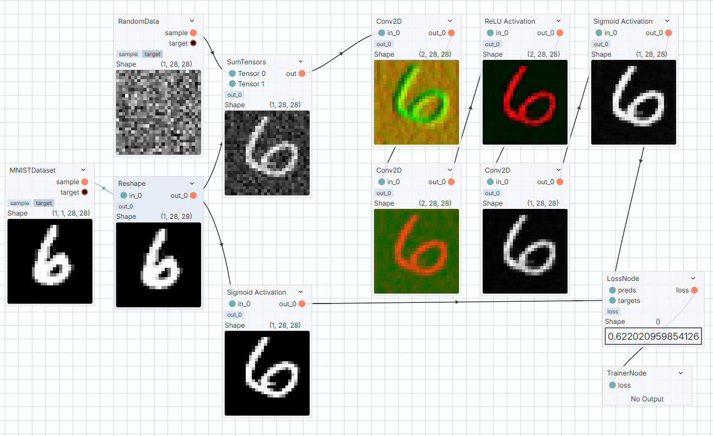
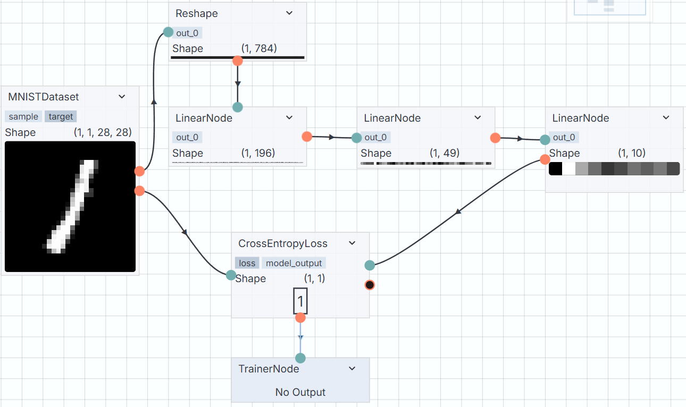

## Feito com [nodeblocks](https://github.com/yDewolf/nodeblocks-server)
Este plugin adiciona alguns nodes que implementam módulos da biblioteca [PyTorch](https://pytorch.org), permitindo que você desenvolva redes neurais simples usando nodes !! Além disso, os nodes apresentam documentação em português que você pode acessar por meio do seu client ([client padrão](https://github.com/yDewolf/nodeblocks-editor)).

## Como instalar:
1. Baixe alguma release em [releases](https://github.com/yDewolf/ytorchplugin/releases);
2. Adicione o arquivo `.nbplugin` a sua pasta de plugins;
3. Não tem.

### Exemplos de grafos que usam esse plugin:
**Todas as imagens a seguir são prints tiradas do [editor padrão](https://github.com/yDewolf/nodeblocks-editor)**

#### Modelo de Remoção de ruído

#### Classificação de dígitos


## Como rodar/desenvolver:
Depois de clonar o repositório:
````
pip install ./lib/nodeblocks
pip install -e .
````
